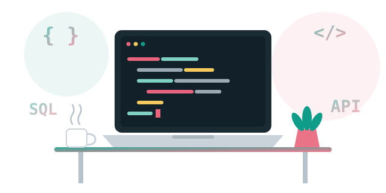

  

<h3 align="center">
  <samp>
    &gt; Hello World!, I am
    <b><a target="_blank" href="https://www.linkedin.com/in/YOUR_LINKEDIN_ID/">KEERTHANA B M</a></b>
  </samp>
</h3>

  <samp>
    「 Backend Developer building reliable APIs, scalable services, and clean, well-designed systems 」
  </samp>

  

  

  
  
  

  
  
  

---

## About

I'm a backend developer who enjoys the part of software users never see: the APIs, data models and services that make everything else work. I care about clean design, reliability and steady growth, and I'm building toward production-grade, scalable systems.

  

---

## Technologies

<table align="center" cellspacing="0" cellpadding="6">
  <tr>
    <td align="center"></td>
    <td align="center"></td>
    <td align="center"></td>
    <td align="center"></td>
    <td align="center"></td>
  </tr>
  <tr>
    <td align="center"></td>
    <td align="center"></td>
    <td align="center"></td>
    <td align="center"></td>
    <td align="center"></td>
  </tr>
  <tr>
    <td align="center"></td>
    <td align="center"></td>
    <td align="center"></td>
    <td align="center"></td>
    <td align="center"></td>
  </tr>
  <tr>
    <td align="center"></td>
    <td align="center"></td>
    <td align="center"></td>
    <td align="center"></td>
    <td align="center"></td>
  </tr>
</table>

  <samp>Java · Spring · Hibernate · Python · FastAPI · Node.js · PostgreSQL · MySQL · SQL Server · MongoDB · Redis · Kafka · RabbitMQ · Nginx · Docker · Git · Linux · Bash · Maven · Postman</samp>

---

## Currently

| Working on | Where I'm headed |
|:--|:--|
| REST APIs with Java and Spring Boot | Scalable, production-grade backend systems |
| Data structures and algorithms | Distributed systems with Kafka, Redis and Docker |
| System design fundamentals | Open-source contributions |

More detail: [**Projects**](docs/PROJECTS.md) · [**Domains**](docs/DOMAINS.md) · [**Collaboration**](docs/COLLAB.md)

---

## Vital Statistics

  

  

---

<table width="100%" border="0" cellspacing="10" cellpadding="0" align="center">
<tr>

<td width="50%" valign="top" align="center">

<h2>Collaboration</h2>

I'm open to collaborating on:

<ul>
  <li>Backend systems and API development</li>
  <li>Web applications and full-stack projects</li>
  <li>DSA and problem solving</li>
  <li>System design and architecture</li>
  <li>DevOps and CI/CD pipelines</li>
</ul>

<a href="docs/COLLAB.md">How I like to collaborate →</a>

</td>

<td width="50%" valign="top" align="center">

<h2 id="-contact">Contact</h2>

 

  

  

</td>

</tr>
</table>

  

