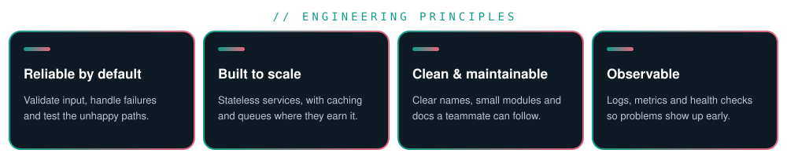

  

  
  
  

  
  
  

---

<b>The areas I focus on sit where backend engineering, system design and problem solving meet.</b>

## Core Domains

| Domain | What it covers | Tools I use |
|:--|:--|:--|
| **Backend & APIs** | REST design, validation, authentication, error handling | Java, Spring Boot, Hibernate, Python, FastAPI, Node.js |
| **Databases** | Relational and document modelling, queries, indexing | PostgreSQL, MySQL, SQL Server, MongoDB |
| **Caching & Messaging** | Faster reads, async work, event-driven flows | Redis, Kafka, RabbitMQ |
| **Containers & DevOps** | Packaging, reverse proxying, repeatable builds | Docker, Nginx, Linux, Bash, Maven |
| **System Design** | Components, trade-offs, scaling and failure modes | Diagrams, design notes |
| **Problem Solving** | Data structures and algorithms for strong fundamentals | Java, Python |

## Key Focus Areas

| Area | Purpose |
|:--|:--|
| Clean API design | Make services easy to use, test and evolve |
| Data modelling | Store data correctly before optimising how it is read |
| Reliability | Plan for failures, retries and bad input from the start |
| Learning in public | Document what I build so others can follow it |

## Engineering Principles

  

  <a href="../README.md">← Back to profile</a>

